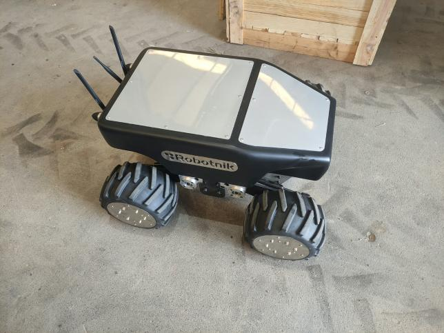
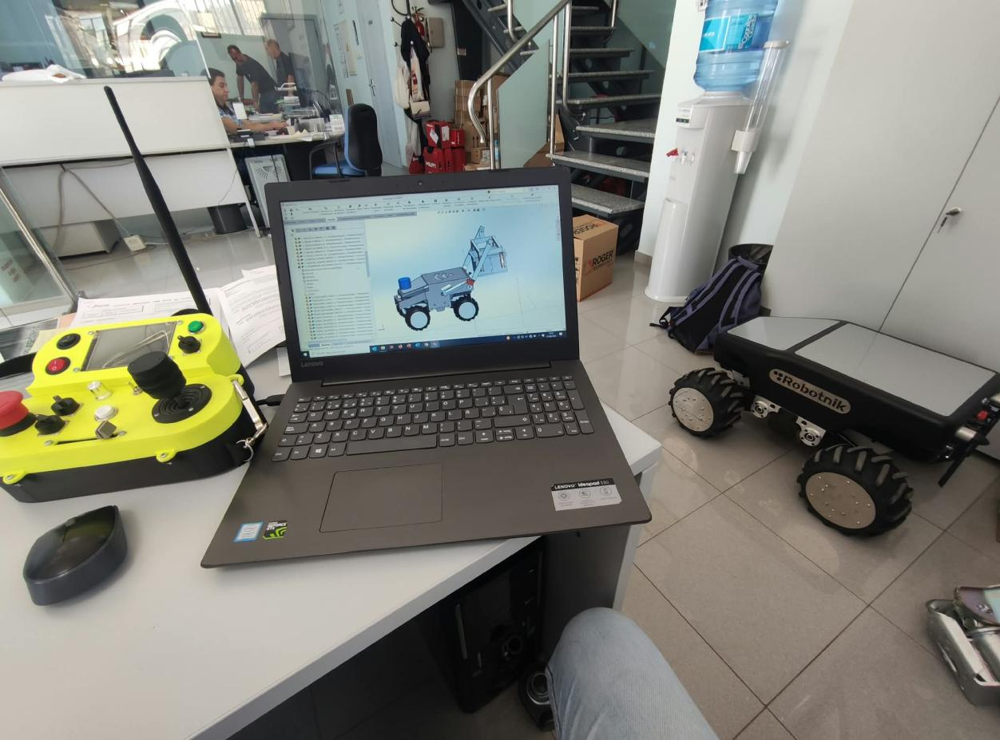
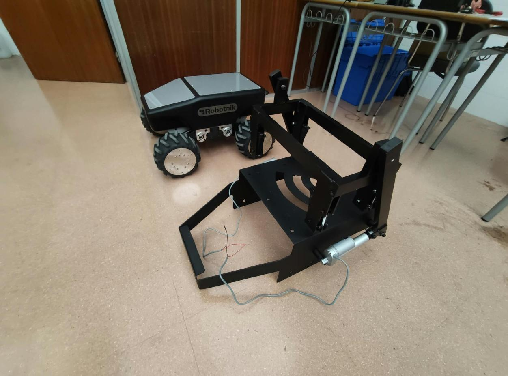
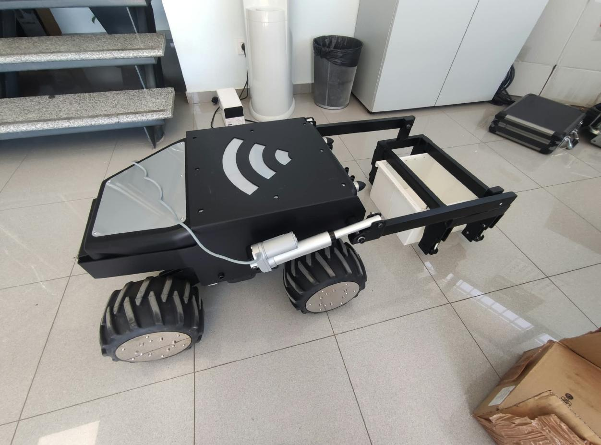
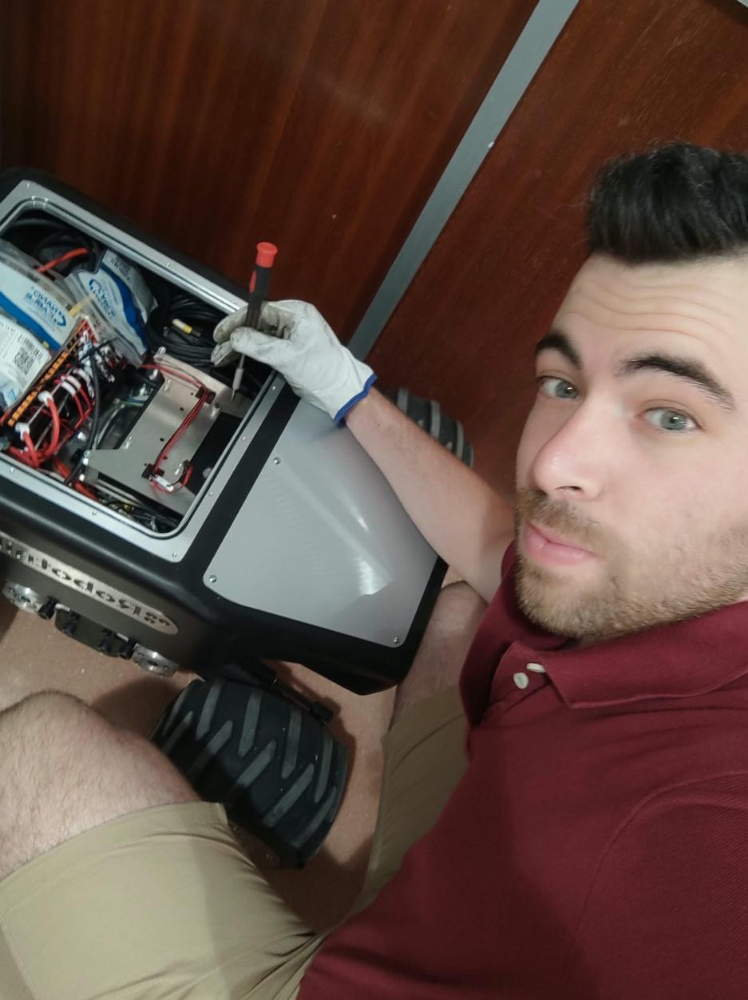
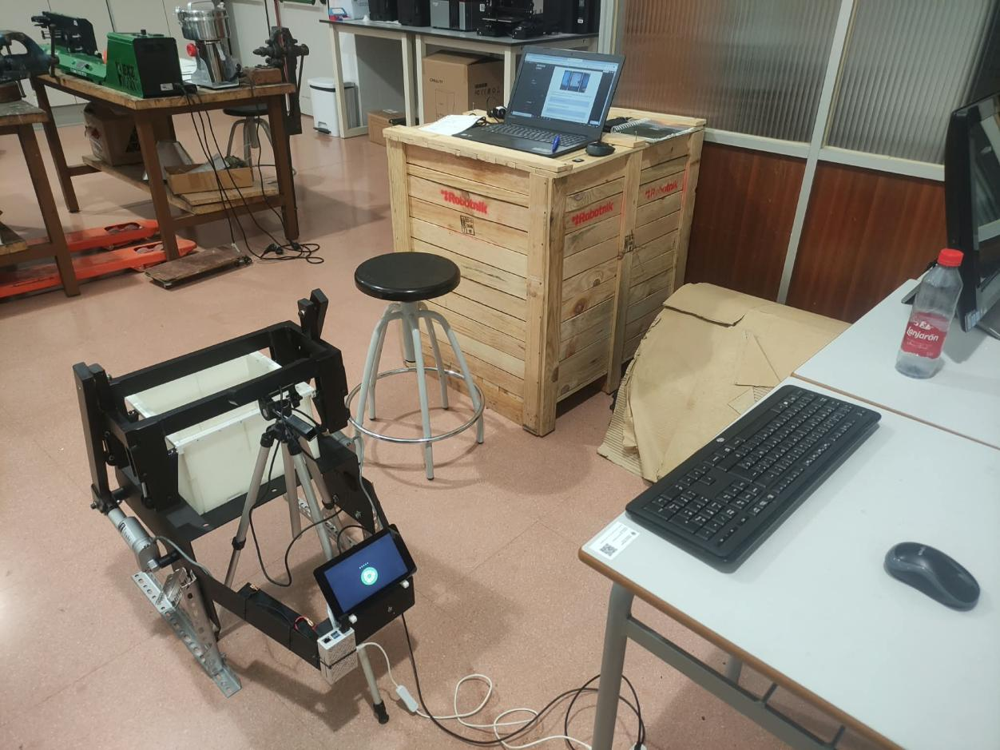
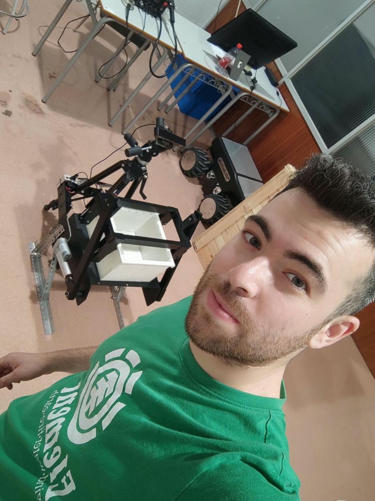
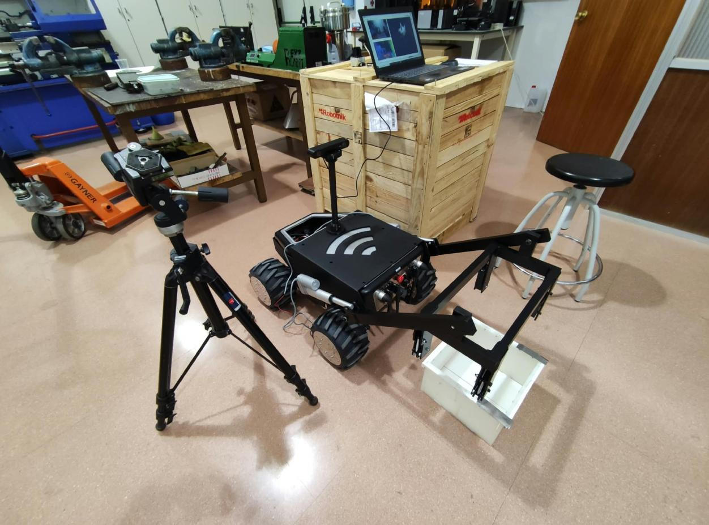

# Mecanismo inteligente para robótica agrícola

**Diseño e integración de un mecanismo para la recogida de cajas en una plataforma móvil AGV/AMR.**

Este trabajo se desarrolló durante el primer año de doctorado, en el marco de la investigación sobre robots móviles aplicados a la logística agrícola. La propuesta combina visión artificial para detectar cajas con actuadores eléctricos para manipularlas desde un robot móvil.

*Plataforma móvil utilizada como base para el desarrollo del mecanismo.*

## Necesidad actual

En la logística agrícola, la recogida de cajas requiere localizarlas y manipularlas como parte del proceso de transporte. La necesidad que aborda este proyecto es avanzar hacia la automatización de esa tarea mediante un robot AGV/AMR que pueda detectar las cajas y participar en su recogida. Para ello, la plataforma móvil debe integrar percepción por visión artificial y un mecanismo de manipulación accionado eléctricamente.

## Objetivo del proyecto

Diseñar, fabricar e integrar en una plataforma móvil un mecanismo inteligente para la recogida de cajas en aplicaciones de logística agrícola. El sistema combina:

- **Percepción:** una cámara y visión artificial para detectar las cajas.
- **Manipulación:** actuadores eléctricos para ejecutar la acción de recogida.
- **Movilidad:** una plataforma AGV/AMR como soporte del sistema.

Mi participación se centró en la investigación y el diseño del mecanismo dentro de esta línea de trabajo.

## Fases del proyecto

### 1. Exploración del problema y de la robótica móvil

Se revisó la aplicación de robots AGV/AMR a la logística agrícola y se tomó como punto de partida una plataforma móvil disponible para el proyecto. El problema de interés fue la recogida de cajas y la integración de la percepción con la manipulación.

### 2. Definición de la solución

Se planteó un sistema en el que la visión artificial detecta las cajas y, posteriormente, se accionan actuadores eléctricos para manipularlas. La propuesta debía poder montarse en el robot y adaptarse al proceso de ensamblaje y a los medios de fabricación.

### 3. Diseño mecánico y CAD

Se diseñó el mecanismo y se preparó su modelo CAD para fabricación. El trabajo siguió criterios DFA (*Design for Assembly*, diseño para el ensamblaje) y tuvo en cuenta las limitaciones de los útiles del fabricante.

*Preparación del diseño CAD y revisión de la solución con la plataforma AGV/AMR.*

### 4. Fabricación y montaje

Tras el diseño, se fabricó el mecanismo y se montó en la plataforma. Las imágenes muestran tanto el prototipo mecánico como su instalación en el robot.

*Prototipo del mecanismo de manipulación.*

*Integración mecánica del mecanismo en el AGV/AMR.*

### 5. Integración de visión artificial y actuadores

Se prepararon pruebas del sistema inteligente con una cámara de visión artificial para detectar cajas y accionar posteriormente los actuadores eléctricos. Así se abordaron conjuntamente la detección y la manipulación.

*Trabajo de integración sobre la plataforma móvil.*

*Montaje experimental con el mecanismo, la cámara y el equipo de pruebas.*

### 6. Pruebas y revisión del prototipo

El material documenta pruebas de detección mediante cámara y el accionamiento posterior de los actuadores para la recogida de las cajas. Las fotografías muestran el conjunto durante las pruebas.

*Revisión del prototipo en el entorno de trabajo.*

*Configuración integrada para las pruebas de visión y manipulación.*

## Resultado documentado

El trabajo llegó al diseño CAD, la fabricación y el montaje de un mecanismo en una plataforma móvil, además de la preparación de pruebas que combinaban detección visual y accionamiento eléctrico. Esto deja una base física para continuar la investigación de la recogida robotizada de cajas en logística agrícola.

El PDF de referencia describe el proceso y muestra el prototipo, pero no aporta métricas cuantitativas de precisión de detección, capacidad de carga, tiempo de ciclo ni rendimiento en campo. Por ello, esta documentación no atribuye esos resultados al proyecto.

## Posibles continuaciones

Como siguientes pasos de investigación, se podrían medir la detección y la recogida en distintas condiciones de iluminación y disposición de las cajas, evaluar la repetibilidad del mecanismo y caracterizar su comportamiento en un entorno agrícola. Son propuestas de evaluación futura, no resultados presentados aquí.

## Contenido del repositorio

- **README.md:** contexto, objetivo, fases y resultado documentado.
- **docs/images/:** fotografías extraídas del PDF de referencia e incorporadas a esta documentación.

El repositorio documenta el proyecto y no incluye actualmente el código de control, el modelo CAD fuente ni los datos de las pruebas.
